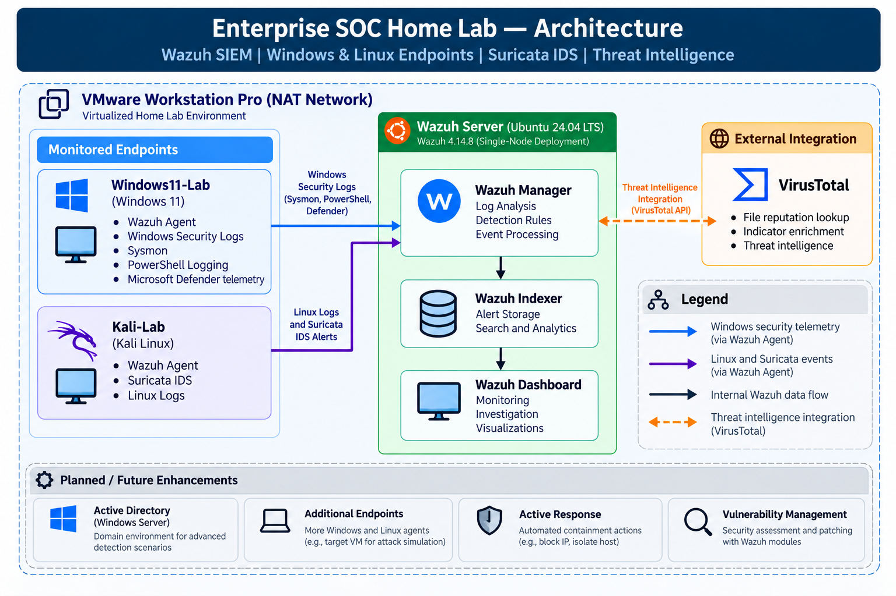
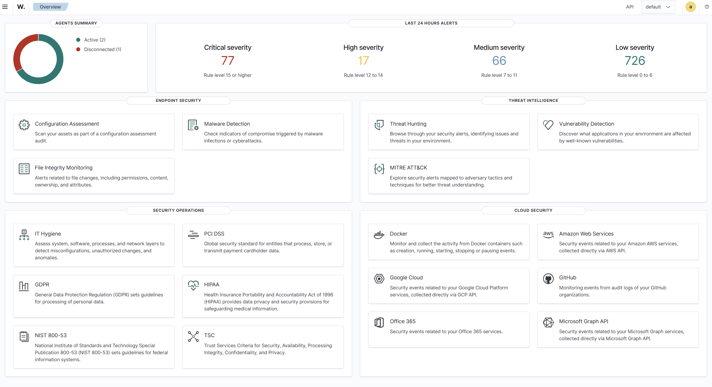
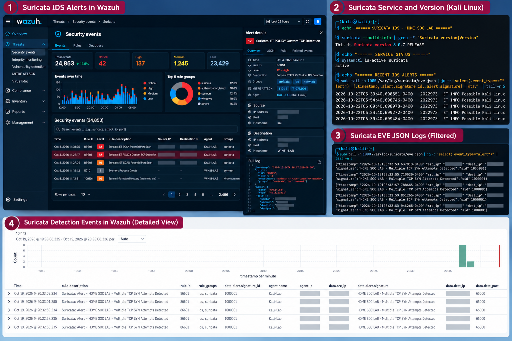

# Cybersecurity Portfolio | Jira Mae Viaña

**Senior SOC Analyst | Incident Responder | Wazuh Specialist | SOC Team Lead**

Welcome to my personal cybersecurity portfolio, showcasing my professional experience, technical skills, and hands-on projects in Security Operations, Incident Response, Threat Detection, and Security Engineering.

🌐 **Live Portfolio:** https://cybersecurity-portfolio-dqg.pages.dev

## About Me

I am a cybersecurity professional with over 3 years of hands-on experience in SOC operations and incident response, progressing from L1 SOC Analyst to Senior SOC Analyst, SOC Team Leader, and Incident Responder.

My experience includes security monitoring, alert triage, threat investigation, incident containment, threat hunting, SIEM operations, and MITRE ATT&CK-aligned detection engineering.

This portfolio highlights both my professional background and practical cybersecurity projects.

## Featured Project — Enterprise SOC Home Lab

A hands-on, enterprise-inspired Security Operations Center environment built to explore SIEM architecture, log collection, endpoint monitoring, detection engineering, and security incident investigation.

**Technology Stack:**
- Wazuh SIEM 4.14.8
- Ubuntu Server 24.04 LTS
- Windows 11 and Kali Linux
- VMware Workstation Pro
- Sysmon and Windows Event Logs
- Microsoft Defender
- Suricata IDS
- VirusTotal Integration

### Implemented Capabilities

- Centralized security monitoring and log collection
- Windows endpoint monitoring with Sysmon
- Custom Wazuh detection rules
- MITRE ATT&CK simulation and detection validation
- Suricata IDS integration
- File Integrity Monitoring
- Microsoft Defender telemetry monitoring
- Threat intelligence enrichment using VirusTotal

### Detection Engineering and MITRE ATT&CK

Implemented and tested custom detection rules covering:

| Technique | Description |
|---|---|
| T1110 | Brute Force |
| T1082 | System Information Discovery |
| T1016 | System Network Configuration Discovery |
| T1105 | Ingress Tool Transfer |
| T1053.005 | Scheduled Task Persistence |
| T1547.001 | Registry Run Key Persistence |
| T1562.001 | Impair Defenses |
| T1057 | Process Discovery |

**Project Repository:** https://github.com/jiraviana/Enterprise-SOC-Homelab

## Portfolio Website Features

- Responsive desktop and mobile layouts
- Professional experience and technical skills
- Featured cybersecurity projects
- MITRE ATT&CK detection case studies
- Security lab evidence and screenshots
- Certifications section
- Resume download
- LinkedIn and GitHub integration

## Website Technology Stack

- React
- Vite
- Tailwind CSS
- JavaScript
- Git and GitHub
- Cloudflare Pages

## Project Screenshots

### Enterprise SOC Lab Architecture



### Wazuh SIEM Dashboard



### MITRE ATT&CK — Defender Tampering Detection


### Suricata IDS Detection



## Local Development

To run this portfolio locally:

```bash
npm install
npm run dev
```

To create a production build:

```bash
npm run build
```

## Deployment

This portfolio is hosted on Cloudflare Pages and connected to GitHub for automatic deployment from the `main` branch.

**Live Website:** https://cybersecurity-portfolio-dqg.pages.dev

## Connect With Me

- **LinkedIn:** https://www.linkedin.com/in/jiramaeviana
- **GitHub:** https://github.com/jiraviana
- **Portfolio:** https://cybersecurity-portfolio-dqg.pages.dev

---

**Project Status:** Active portfolio development and ongoing cybersecurity lab improvements.

*All security testing and attack simulations are performed in an authorized, isolated home lab environment for educational and professional development purposes.*
